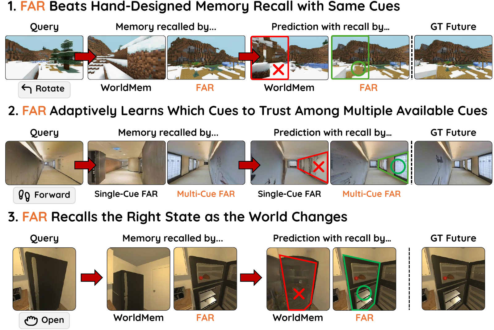
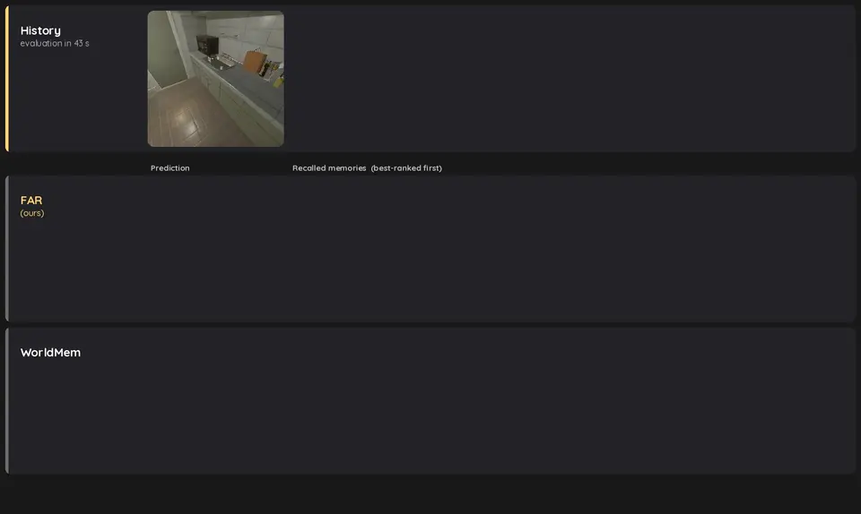

<div align="center">

# Learning What to Recall: Adaptive Multi-Cue Episodic Memory for World Models

**Beomsu Kim**<sup>1</sup> · **Chieh-Hsin Lai**<sup>2</sup> · **Bac Nguyen**<sup>2</sup> · **Amir Bar**<sup>3</sup> · **Jong Chul Ye**<sup>1,†</sup> · **Yuki Mitsufuji**<sup>2,†</sup>

<sup>1</sup>KAIST &nbsp;·&nbsp; <sup>2</sup>Sony Group Corporation &nbsp;·&nbsp; <sup>3</sup>Imperial College London &nbsp;&nbsp; <sup>†</sup>Corresponding authors

[](https://arxiv.org/abs/2609.34677)
[](https://1202kbs.github.io/FAR-Project-Page/)
[](https://huggingface.co/collections/1202kbs/learning-what-to-recall-far-6abc76068f6e916201cfd078)
[](LICENSE)

</div>

<p align="center">
  
</p>

Code for Future-Aware Recall (FAR): the model, the retrieval baselines, training and evaluation,
and the analysis notebooks, for four corpora: **LoopNav** (Minecraft), **SoundSpaces**
(audio-visual navigation in Matterport3D scenes), **AI2-THOR** (object-interaction tours) and
**AI2-THOR-dyn** (a corridor with a second, moving agent).

## Installation

```bash
git clone https://github.com/sony/far.git far && cd far
bash bash_scripts/setup_env.sh      # conda env "far" with the paper's exact versions (Python 3.12, PyTorch 2.7, CUDA 12.8)
conda activate far
```

Without conda: `pip install -r requirements.txt --extra-index-url https://download.pytorch.org/whl/cu128 && pip install -e .`

## Quickstart

```bash
bash bash_scripts/quickstart.sh
```

Downloads FAR and WorldMem for AI2-THOR plus the demo clips (2.4 GB), rolls both through one
test episode in which the agent revisits kitchen stations it changed earlier, and writes a
side-by-side video with a correct / wrong-state verdict at each revisit to
`results/quickstart/clip350/`. About 8 minutes and 14 GB of GPU memory on one H100. Options:
`--arms`, `--clip`, `--max-steps`. Clip 350 is illustrative; the paper reports full test sets.

<p align="center">
  
</p>
<p align="center"><sub>The quickstart's <code>rollout.mp4</code> (exploration leg sped up 4&times;): at the drawer revisit FAR recalls the frames where the tomato went in; WorldMem recalls mostly recent views and renders the wrong state.</sub></p>

## Downloads

Checkpoints and pre-computed latents are on
[Hugging Face](https://huggingface.co/collections/1202kbs/learning-what-to-recall-far-6abc76068f6e916201cfd078)
and land in `models/` and `datasets/`:

```bash
bash bash_scripts/download.sh checkpoints              # all checkpoints (~13 GB), or name corpora: checkpoints ai2thor_v3
bash bash_scripts/download.sh demo ai2thor_v3          # latents: demo | test | train (train includes test)
```

Corpora: `loopnav`, `soundspaces_v1`, `soundspaces_v2`, `ai2thor_v3`, `ai2thor_dyn`.

- **SoundSpaces** is rendered from Matterport3D scenes and is
  [gated](https://huggingface.co/datasets/1202kbs/FAR-Datasets-SoundSpaces): accept the
  Matterport3D Terms of Use there, then run `hf auth login`.
- **LoopNav** is redistributed with its authors' permission; please cite
  [LoopNav](https://arxiv.org/abs/2505.22976). It is the May 2026 release of `kevinLian/LoopNav`,
  which has since been replaced upstream, so use these latents to reproduce the paper.

| Corpus | Checkpoints in `models/<corpus>/` |
|---|---|
| `loopnav` | `temporal`, `worldmem`, `longlive_rag`, `far_meta`, `far_visual`, `far_multicue`, `far_frozen_encoder`, `far_ablation_z`; retrievers `retriever_jepa`, `retriever_longlive` |
| `soundspaces_v1` | `temporal`, `worldmem`, `far_meta`, `far_multicue`; retriever `retriever_audio` |
| `soundspaces_v2` | `temporal`, `worldmem`, `far_meta`, `far_multicue` |
| `ai2thor_v3` | `temporal`, `worldmem`, `far_multicue`; retriever `retriever_jepa` |
| `ai2thor_dyn` | `temporal`, `worldmem`, `far_meta`, `far_multicue`; retriever `retriever_object` |

Checkpoints are the paper's (step 700k; 500k for AI2-THOR-dyn) and are inference-only. The
retrievers are the pre-trained encoders the FAR launchers start from. Internal names in configs
(`pnp`, `vmz`, `thor3`, ...) are decoded in [docs/GLOSSARY.md](docs/GLOSSARY.md).

## Training

Launchers under `bash_scripts/<corpus>/` are the exact commands behind the paper's arms:

| Corpus | Launchers | Arms |
|---|---|---|
| LoopNav | `train_ldwm_{temporal,worldmem,longlive}.sh` | Temporal, WorldMem, LongLive-RAG |
| | `train_ldwm_pnp_meta_only.sh`, `train_ldwm_pnp_visual_only.sh`, `train_ldwm_pnp.sh`, `train_ldwm_pnp_ablation.sh` | FAR: Meta, Visual, Multi-Cue, fixed-weight ablation |
| SoundSpaces v1 / v2 | `train_ldwm_{temporal,worldmem,pnp_meta_only,pnp_cue_metaz}.sh` | Temporal, WorldMem, FAR: Meta, Multi-Cue |
| AI2-THOR | `train_ldwm_{temporal,worldmem,pnp_vmz}.sh` | Temporal, WorldMem, FAR: Multi-Cue |
| AI2-THOR-dyn | `train_ldwm_{temporal,worldmem,pnp_meta_A_nocue,pnp_meta_B_rag}.sh` | Temporal, WorldMem, FAR: Meta, Multi-Cue |

Retriever pre-training (`pretrain_*retriever*.sh`) and key caching (`precompute_keys*.sh`, only
needed for a retriever you trained yourself) sit next to them; SoundSpaces v2 and AI2-THOR-dyn use
the SoundSpaces v1 and AI2-THOR key launchers.

```bash
bash bash_scripts/download.sh train ai2thor_v3         # training data
bash bash_scripts/download.sh checkpoints ai2thor_v3   # includes the pre-trained retriever FAR starts from
GPUS=0,1,2,3 bash bash_scripts/ai2thor/train_ldwm_pnp_vmz.sh
```

Settings are environment variables: `GPUS` (one rank per GPU), `BATCH` / `EVAL_BATCH` (per-GPU
batch, default the paper's), `CKPT` (the retriever a FAR launcher starts from) and, for
`ai2thor/pretrain_retriever.sh`, `DATASET`. The paper used 80 GB GPUs; a smaller effective
batch (`BATCH` × GPUs) will not reproduce it exactly. The released AI2-THOR retriever was
pre-trained on an unreleased earlier AI2-THOR corpus; pre-training on v3 gives a comparable one.

To resume, add `from_checkpoint=results/<run>/checkpoints/latest.pth.tar` to the overrides
inside the launcher and run it again; the launchers take no command-line arguments. Runs write
to `results/<timestamp>__...__<run_name>__bs<N>__<dataset>/` and log to Weights & Biases
(`wandb.mode=offline` to disable). Per-machine settings go in `bash_scripts/env.local.sh`
(see `env.local.sh.example`).

## Evaluation

Download the test tier (`bash bash_scripts/download.sh test <corpus>`), then run the paper's
rollout battery; it writes one resumable `.npz` record per (arm, clip), sharded over GPUs:

```bash
EVAL_GPUS="0 1 2" bash bash_scripts/loopnav/eval_rollout_sharded.sh          # configs/eval_rollout_loopnav.yaml
EVAL_GPUS="0 1 2" bash bash_scripts/soundspaces/eval_rollout_sharded.sh      # configs/eval_rollout_soundspaces.yaml
EVAL_GPUS="0 1 2" bash bash_scripts/soundspaces_v2/eval_rollout_sharded.sh   # configs/eval_rollout_soundspaces_v2.yaml
EVAL_GPUS="0 1 2" bash bash_scripts/ai2thor/eval_rollout_sharded.sh          # configs/eval_rollout_thor.yaml
```

`notebooks/rollout_*_analysis.ipynb` turn the records into the paper's tables and curves;
`notebooks/rollout_{loopnav,soundspaces,ai2thor}.ipynb` roll every arm on one clip with
comparison grids and videos (`FAR_DEVICE=cuda:N` picks the GPU).

AI2-THOR-dyn is evaluated with the both-ends probe: each arm generates the reveal at both
corridor ends, and a latent agent detector (released) reads out which end it painted.

```bash
EVAL_GPUS="0 1 2" bash bash_scripts/ai2thor_dyn/probe_both_ends_sharded.sh
python scripts/ai2thor_dyn/aggregate_paint_both_ends.py results/paint_both_ends 10
```

## Repository layout

```
src/far/        model (models/), generators, retrievers (memories/), tokenizers, data pipeline, analysis
configs/        Hydra configs: training, pre-training, evaluation, model/, dataset/
scripts/        trainers and evaluators (world/), dyn probe (ai2thor_dyn/), data tools (data/), quickstart, downloads
bash_scripts/   setup, downloads, quickstart and the per-corpus training / evaluation launchers
notebooks/      rollout and analysis notebooks
docs/           GLOSSARY.md: internal names -> paper names
tests/          unit tests
```

## License

CC BY-NC 4.0 (`LICENSE`). Parts of the generator, diffusion and utility code are adapted from
Navigation World Models and DiT (Meta Platforms, CC BY-NC 4.0); other third-party code, weights
and data are listed in `THIRD_PARTY_NOTICES.md`.

## Citation

```bibtex
@article{kim2026far,
  title   = {Learning What to Recall: Adaptive Multi-Cue Episodic Memory for World Models},
  author  = {Kim, Beomsu and Lai, Chieh-Hsin and Nguyen, Bac and Bar, Amir and Ye, Jong Chul and Mitsufuji, Yuki},
  journal = {arXiv preprint arXiv:2609.34677},
  year    = {2026},
  url     = {https://arxiv.org/abs/2609.34677}
}
```

## Acknowledgements

Built on [Navigation World Models](https://github.com/facebookresearch/nwm) and
[DiT](https://github.com/facebookresearch/DiT); the WorldMem baseline follows
[WorldMem](https://github.com/xizaoqu/WorldMem). Data: [LoopNav](https://arxiv.org/abs/2505.22976)
(redistributed with its authors' permission), [SoundSpaces](https://github.com/facebookresearch/sound-spaces)
with Matterport3D, and [AI2-THOR](https://ai2thor.allenai.org).
